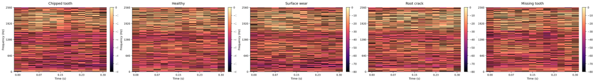
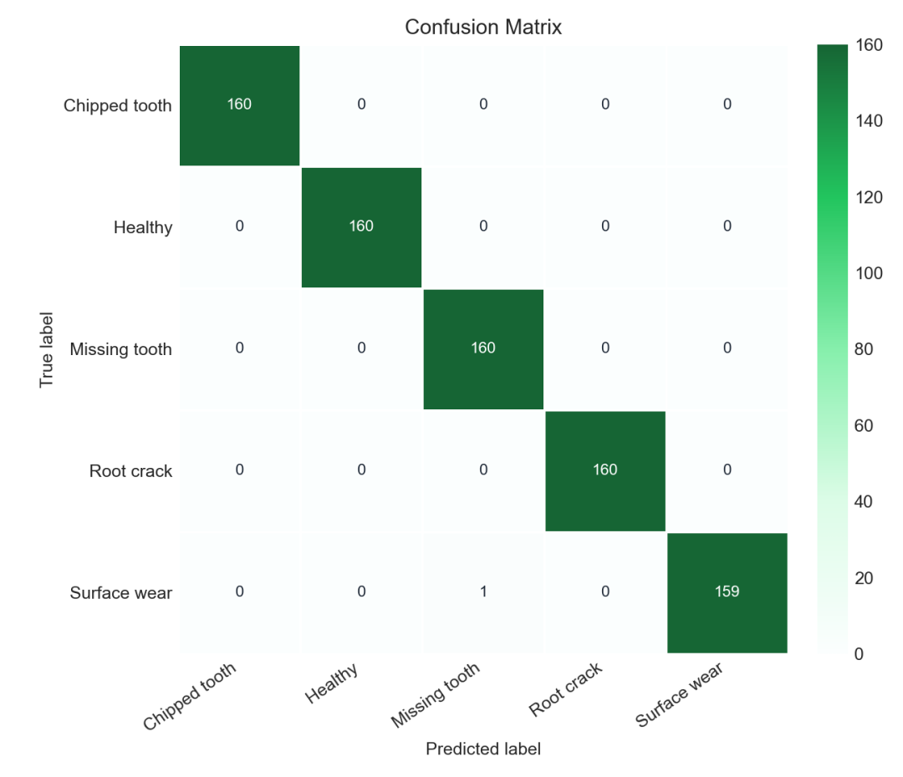
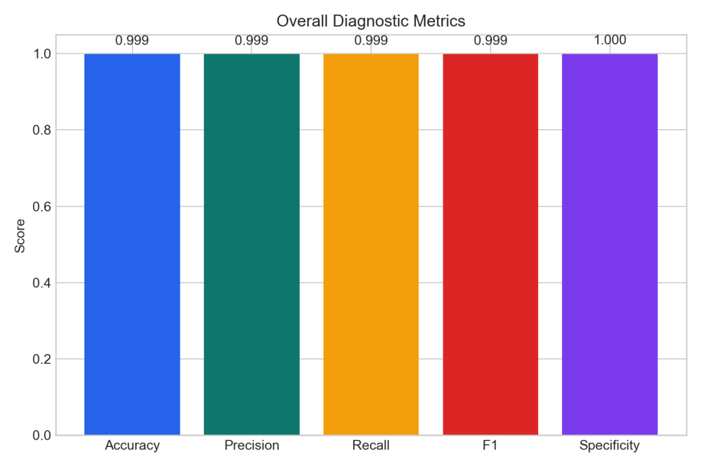
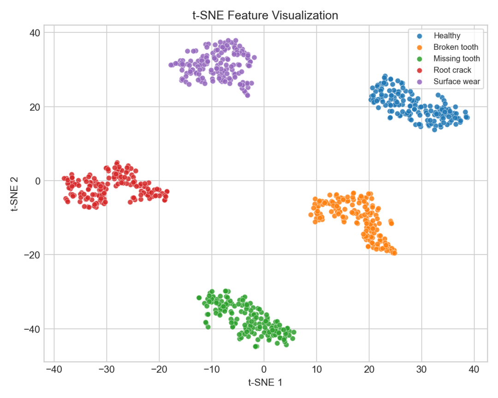
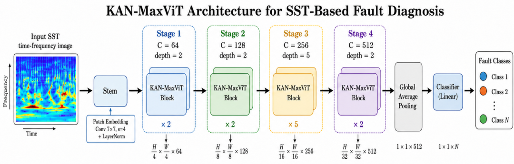
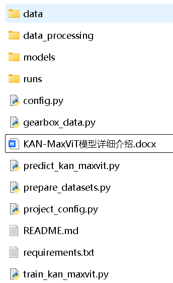

# Gearbox Fault Diagnosis of the High-Innovation Model KAN-MaxViT

This project revolves around the data of gearboxes from Southeast University and WT-planetary gearbox data, innovating a novel diagnostic model: KAN-MaxViT. The code shared in this session includes: original data organization (including two types of data and four working conditions), signal segmentation, synchronous compression time-frequency transformation (SST), dataset division, training of KAN-MaxViT network, testing and evaluation, and results visualization.
What has been accomplished in this project? The main tasks completed include the following.
Firstly, access to two types of gearbox diagnostic data. The project supports data from Southeast University gearboxes and WT planetary gearboxes. Among them, Southeast University data includes two sets of data - condition 20 and condition 30; WT data includes condition 1 and condition 2. During training, you can directly choose seu20, seu30, wt1 or wt2, corresponding to different data sources and different working conditions.
Secondly, convert one-dimensional vibration signals into synchronous compression time-frequency diagrams (SST). Gearbox fault signals often have obvious non-stationarity, which is not intuitive to observe only from the time domain or frequency domain. This project uses synchronous compression transformation to map vibration segments to two-dimensional time-frequency diagrams, making the impact of fault shocks, frequency modulation, and energy distribution changes more clear.
Thirdly, build the KAN-MaxViT network to complete fault classification. After processing, the synchronous compression time-frequency diagrams are used as input for the network, and KAN-MaxViT automatically learns the differences between different fault categories, and outputs the final diagnostic results.
Fourthly, automatically generate training and evaluation results. After the model is trained, the project will save the optimal weight file and output accuracy, precision, recall, F1 value, confusion matrix, training curve, classification report, and prediction result table, facilitating subsequent analysis and presentation.
Overall process The overall process of this project can be summarized as follows:
Original MAT Vibration Data:
Southeast University Gearbox Data Processing: Southeast University's default slice parameters are as follows:
Parameters
Default value
Meaning
Channel 3 captures the third channel vibration signal, with channel numbers using a 1-based system.
Offset 1000 starts from the 1000th sample point and avoids the initial transient.
Segment length 2048: Each sample contains 2048 sampling points.
Window_Step1000: The sliding window step is 1000 sample points.
samples_per_class800: Extract 800 samples per class.
Sample rate 5120 Hz
Therefore, each SEU dataset ultimately contains:
5 Classes × 800 samples = 4000 samples\nEach sample is a one-dimensional vibration signal of length 2048, with class labels from 1 to 5 before conversion.
WT Planetary Gearbox Data Processing: WT data is organized by fault type and condition, with project support for conditions 1 and condition 2. The directory structure is roughly as follows:
Healthy/1/*.MAT, Healthy/2/*.MAT, Broken/1/*.MAT, Broken/2/*.MAT, Missing_tooth/1/*.MAT, Missing_tooth/2/*.MAT, Root_crack/1/*.MAT, Root_crack/2/*.MAT, Wear/1/*.MAT, Wear/2/*.MAT
HealthyBroken toothMissing toothRoot crackSurface wear\nWT data default slice parameters are as follows:
Parameters
Default value
Meaning
condition1  
Or 2
WT, Conditional Work Tag Number, select either wt1 or wt2 during training.
Segment length: 4096 Each sample contains 4096 sampling points.
Segments per file 100: Each MAT file is uniformly divided into 100 sample windows.
All channels
The default is to use all four channels in Data.
Sample rate 48000 Hz is read from the SampleRate in the MAT file by default.
WT, for each condition, there are 8 MAT files per category, with each file containing 100 samples. Therefore, in each condition, the final result includes:
5 Classes × 8 Files × 100 Windows = 4000 Samples
Use Hann window to compute STFT.
Expand the STFT phase and estimate the instantaneous frequency based on the phase time derivative.
Reallocate STFT energy to more accurate frequency positions based on instantaneous frequencies.
Converted to dB energy plot and cropped dynamic range.  
Use magma color map for shading.  
Scaled to an RGB image of 224 × 224 × 3.  
The default parameters for synchronizing compression transformation are as follows:  
Data source  
n_fft_lengthtop_dbmagnitude_threshold output size  
SEU  
512128801e-8224 × 224 × 3WT  
1024256801e-8224 × 224 × 3  
In which, n_fft controls the length of the STFT analysis window, hop_length controls the step between adjacent frames, top_db controls the dynamic range of the time-frequency diagram, magnitude_threshold is used to filter coefficients with small magnitudes to avoid excessive participation of low-energy noise in redistribution.  
After the generation of the time-frequency diagram, the project will perform a layered random division, ensuring that each category maintains relative balance in the training set, validation set, and test set.  
The default division ratio is:  
Dataset  
Ratio  
Training set  
65% Validation set  
15% Test set  
20%  
For a dataset of 4000 samples, the default division result is approximately:  
Training set: 2600 Validation set: 600 Test set: 800\nRandom seed is set to 42 to ensure the data division is reproducible.  
Result display reserves several spots for result images, which can be replaced later with actual training result images.  
Synchronized compression time-frequency plot example  
Figure 1 shows the synchronization compression time-frequency plot of the gearbox state at Southeast University, indicating that the original one-dimensional vibration signal undergoes time-frequency transformation, making the distribution of fault characteristics in both time and frequency more intuitive.
1. Convergence during model training, including changes in training loss, validation loss, training accuracy, and validation accuracy.
2. Confusion matrix for data conditions 1: 
3. Confusion matrix for data conditions 2: 
4. Visualization of feature distributions
5. t-SNE visualization is also implemented in the code, allowing the distribution of high-dimensional features extracted by the model in two-dimensional space to be displayed.
6. Model innovation points: The overall idea proposed in this project for obtaining KAN-MaxViT can be summarized as follows:
7. MaxViT captures both local and global time-frequency correlations
8. KAN enhances the model's nonlinear feature modeling capability
9. This model combines the attention modeling capabilities of MaxViT with the nonlinear function expression abilities of KAN.
10. The unique feature of MaxViT is its inclusion of both local window attention and global grid attention. Local window attention focuses on the details of local areas in the time-frequency graph, such as the sudden energy change due to fault impact; while global grid attention establishes cross-regional information connections, capturing the correlation patterns between different frequency bands and time segments. For gearbox fault diagnosis, fault characteristics often manifest both locally and globally, making this combination of local and global attention structure highly adaptable.
11. The introduction of KAN further enhances the model's ability to express complex nonlinear features. In traditional neural networks, the feedforward module usually uses linear layers plus activation functions to complete feature mapping, whereas KAN uses learnable spline basis functions to represent nonlinear relationships, enabling the network to have more flexible function fitting capabilities during feature transformation. Gearbox vibration signals inherently possess strong non-stationarity, strong coupling, and nonlinear characteristics, and the KAN module helps the model to depict these complex changes more meticulously.
This project employs KAN in the feedforward network section of MaxViT, enhancing the model's nonlinear feature modeling capabilities while preserving its attentional structure characteristics. In other words, MaxViT is responsible for establishing local and global connections from the time-frequency graph, while KAN enhances the expressiveness of the feature mapping stage, forming a complementary relationship. The KAN-MaxViT model architecture is as follows:

The core innovation point of the KAN-MaxViT model lies within this project; it is not convenient to display here, but the detailed network structure diagram and introduction are included in the code compression package. 

For code access, please refer to the code directory screenshot:

In the README, the project usage method is clearly explained, and in the "KAN-MaxViT Model Detailed Explanation.docx", the construction method of the KAN-MaxViT model is described in detail.

Code acquisition methods:

\n        \n

## Images

<!-- PAYMENT_BLOCK -->

## Get this dataset

- Payment link (Stripe): [Buy now](https://buy.stripe.com/3cs8yP7sY87d0vu9AB)
- Payment QR code: 

<!-- /PAYMENT_BLOCK -->
